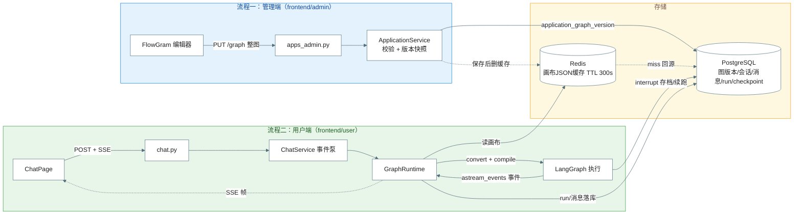
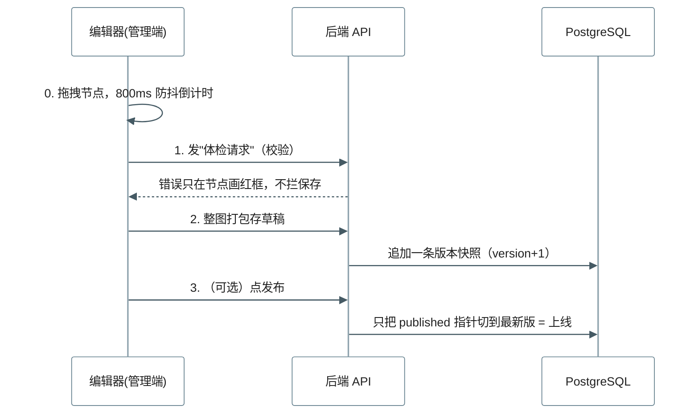
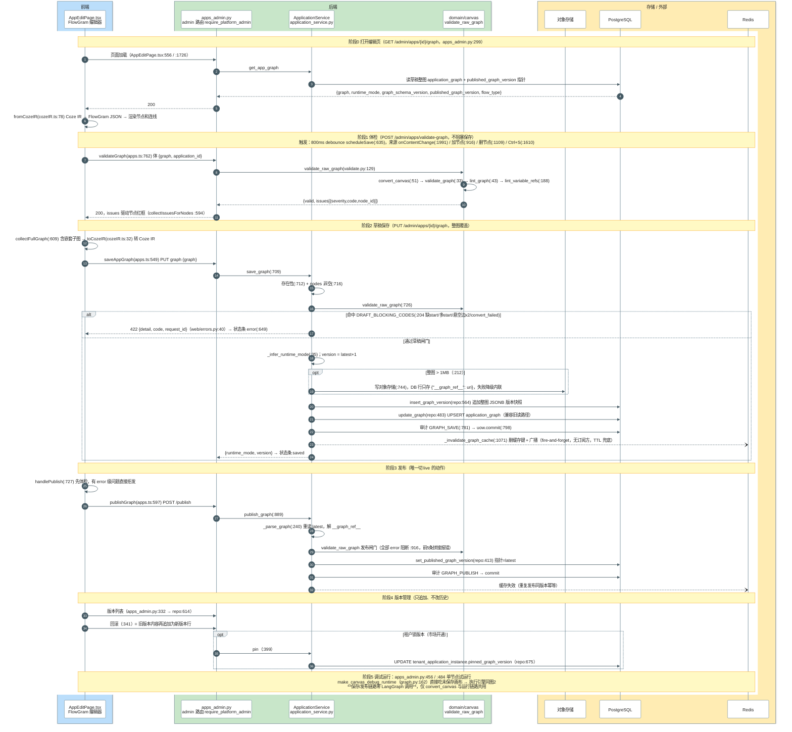
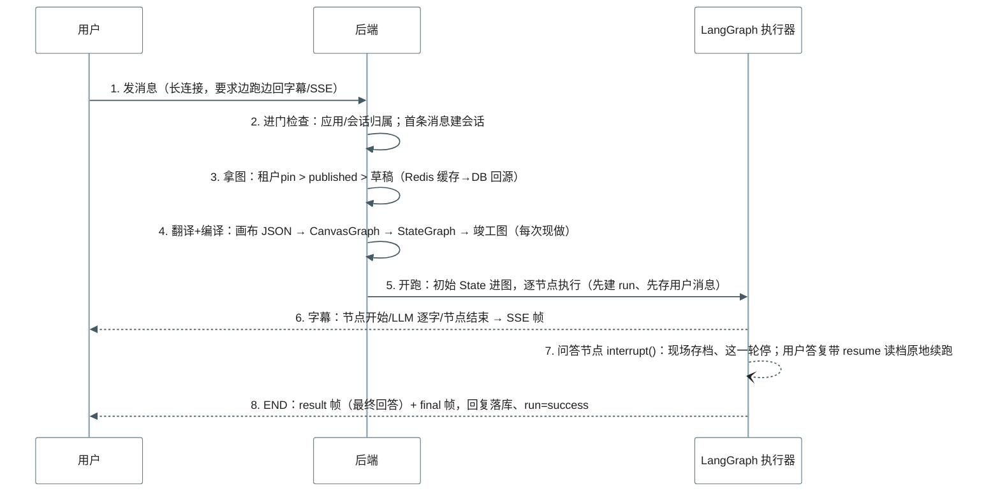

# 画布保存与对话引擎 · 整体时序文档

> 行号以 2026-11-06 HEAD 为准。
> 阅读路径：**第 1 章**看全貌 → **第 3/4 章**每条流程"极简图 → 完整图 → 分步讲解" → **第 5/6 章**查代码细节。

## 目录

- [1. 一页速览](#1-一页速览)
- [2. 概念词典](#2-概念词典)
- [3. 流程一：管理端画布保存](#3-流程一管理端对话流画布保存)（含 **3.4 画布最终保存结构 / Schema 说明书**）
- [4. 流程二：用户端对话引擎](#4-流程二用户端对话引擎一次-chatflow-运行)
- [5. LangGraph API 对照表](#5-langgraph-api-对照表本项目封装点)
- [6. 常见疑问 FAQ](#6-常见疑问faq)

---

## 1. 一页速览

### 1.1 系统全景

两条流程在「画布 JSON」处交汇：**保存流程生产版本 JSON，运行流程消费版本 JSON**，中间靠"版本指针 + Redis 缓存"衔接。



### 1.2 三条铁律（理解两条流程的关键）

| # | 铁律 | 含义 |
|---|---|---|
| 1 | 草稿不影响线上 | 运行永远按 **租户 pin > published > latest** 选版本；发布=只改一根指针 |
| 2 | 保存不编译，运行才编译 | 保存链路零 LangGraph 调用；每次运行请求现做 convert+compile（纯内存毫秒级） |
| 3 | checkpoint ≠ 聊天记忆 | checkpoint 存"图跑到一半的现场"（中断续跑用）；多轮记忆在 Postgres `message` 表，LLM 节点按需回捞 |

### 1.3 数据落点总表

| 数据 | 表/位置 | 写入时机 |
|---|---|---|
| 画布版本快照 | Postgres `application_graph_version`（JSONB，>1MB 转对象存储留 ref） | 每次保存追加一行（version+1） |
| 当前草稿 | Postgres `application_graph`（UPSERT 覆盖） | 每次保存 |
| live 指针 | `application.published_graph_version` | 发布 |
| 租户锁版本 | `tenant_application_instance.pinned_graph_version` | 市场开通/pin |
| 会话 / 消息 | Postgres `conversation` / `message` | 首条消息建会话；用户消息先于执行落库，最终回复流结束提交 |
| 执行账本 | `run`（含画布快照）/ `run_node_execution` / `tenant_usage_ledger` | run 先建，每节点即时写 |
| 断点存档 | LangGraph checkpoint 表（Postgres） | interrupt 时全量写，resume 后继续更新 |
| 画布缓存 | Redis `graph:{app}:v{ver}`，TTL 300s | 读时回填，保存/发布时删除 |

---

## 2. 概念词典

| 名词 | 大白话解释 |
|---|---|
| 画布 / graph | 对话流在编辑器里拖出来的"流程图"。节点=一个个步骤，连线=步骤怎么走 |
| FlowGram | 管理端编辑器框架（@flowgram.ai/free-layout-editor），只管"显示和编辑"，不懂业务 |
| Coze IR | 画布的标准存档 JSON：`{nodes[], edges[], variables}`，字段风格学 coze。**前端画的、数据库存的、后端编译的都是这个格式** |
| CanvasGraph IR | Coze JSON 在 domain 层的 Python 对象化（表达式、子图、错误策略都变成强类型），是"翻译中间语" |
| 草稿 / 发布 / 版本 | 每保存一次=追加一条整图快照（版本号+1，只追加不改历史）；发布=把指针切到最新版 |
| 租户 pin | 某租户开通应用时钉住某版本，之后平台再发布新版也不影响它 |
| LangGraph | LangChain 团队的开源"状态机执行器"：按图顺序调节点、节点间传共享状态字典、支持分支/循环/中断续跑 |
| StateGraph / CompiledStateGraph | LangGraph 里"正在建的图"和"竣工可跑的图"。本项目 Compiler 从画布 JSON 造前者、`compile()` 出后者 |
| WorkflowState | 节点之间传递的数据包（TypedDict）：用户输入、各节点输出、全局变量池、最终 output |
| checkpointer / checkpoint | LangGraph 的"存档系统"。每步把 State 落库，图可停一半以后接着跑。本项目用 `AsyncPostgresSaver`（存 Postgres） |
| `interrupt()` / `Command(resume)` | LangGraph 一对 API：节点内喊"停下等我拿人类输入" / "输入给它、从断点原地继续"。用于问答节点、人工审核 |
| `astream_events` | LangGraph 的"实况解说"：每进入/离开节点吐一个事件，后端翻译成前端消息 |
| SSE | 服务器单向推送：HTTP 连接挂着，服务器持续发小帧 `event: xxx\ndata: {...}\n\n`，前端逐帧渲染（打字机效果） |
| 节点 Handler | 每种节点的 Python 执行逻辑：LLM 节点=调大模型，IF 节点=比大小，HTTP 节点=发请求 |

**分层地图（DDD）**

```
frontend/admin（编辑器+保存）      frontend/user（会话+运行）
        ↓ HTTP                            ↓ POST / SSE
web/            FastAPI 路由、鉴权、SSE 组装（"前台"）
application/    业务编排：save_graph / publish_graph / ChatService 事件泵（"管家"）
domain/         纯业务：画布校验、IR 转换、LangGraph 编译、运行循环（"工厂"，不 import 网络/数据库）
infrastructure/ PostgreSQL / Redis / 对象存储 仓储实现（"仓库管理员"）
```

组合根：运行链路的所有跨层依赖（LLM 客户端、仓储、消息适配器）在 `web/deps/graph.py:build_runner` 集中装配后注入 domain——这是 domain 层能保持纯净的原因。

---

## 3. 流程一：管理端对话流画布保存

### 3.1 极简版（30 秒看懂）



一句话：**保存=攒版本，发布=切指针**。

### 3.2 完整时序图



> **配色说明**：全图只铺**一块白色底纸**（单层 rect、不再分段上色——分段色带按消息跨度自动收缩宽度，导致宽窄参差；嵌套色带更有错位 bug），深浅两种背景渲染完全一致。参与者头部底色=所属层（🔵前端 / 🟢后端 / 🟠存储外部）；阶段划分由**贯穿全宽的黄色横幅注释**（阶段0~5）标示。

### 3.3 分阶段讲解

| 阶段 | 干什么 | 为什么这样设计 | 失败会怎样 |
|---|---|---|---|
| 0 打开 | GET 读草稿整图 + 版本指针，`fromCozeIR` 还原成编辑器可渲染格式 | 编辑对象永远是草稿最新版，与线上解耦 | 应用不可见统一 404 |
| 1 体检 | 转 IR → 结构校验 → lint，返回 issues | **校验与保存解耦**：半成品也能存，红框即时反馈 | 体检接口自身失败不影响编辑 |
| 2 保存 | 草稿闸门（5 种致命错误）→ version+1 追加快照 + UPSERT 草稿表 + 审计 + 删缓存 | 整图快照=可回滚可追溯；>1MB 外置防大行 | 422 VALIDATION_ERROR，状态条报错，可重试 |
| 3 发布 | 全量 error 闸门 + 指针切换 | 发布是**唯一**让改动生效的动作，闸门从严；幂等 | 有 error 拒发，线上保持旧版 |
| 4 版本 | 列表/回滚/租户 pin | 回滚=追加而非改写（审计链完整）；pin 保护租户存量行为 | — |
| 5 调试 | 未保存画布直接跑 | 试错成本零：不产生版本、不动指针 | 走 debug 会话，不污染真实消息 |

### 3.4 画布的最终保存结构（Schema 说明书）

**三层同心**：数据库行（外壳）→ 整图 JSON 快照（schema_json 列，即 Coze IR）→ 运行时被翻译成的 CanvasGraph IR（Python 对象，见 4.3 步⑥，不在库里存储）。本节讲前两层。

#### 3.4.1 数据库外壳：两张表 + 一根指针

| 表 | 定位 | 列 |
|---|---|---|
| `application_graph` | **当前草稿**，与应用 1:1 | `application_id`(PK, FK→application, CASCADE) · `schema_json`(JSONB 整图) · `graph_schema_version`(int, 默认 1) · `runtime_mode`(`dag`/`agent_loop` CHECK 约束) · `created_at` · `updated_at` |
| `application_graph_version` | **版本历史**，每次保存追加一行 | `id`(PK) · `application_id`(FK) · `version`(int) · `schema_json`(JSONB 整图快照) · `runtime_mode` · `changelog`(text) · `created_by`(uuid) · `created_at`；唯一约束 `(application_id, version)`，索引 `(application_id, version DESC)` |
| `application.published_graph_version` | **live 指针**（int，指向版本表的 version） | 发布=改它；NULL=从未发布 |
| `tenant_application_instance.pinned_graph_version` | **租户锁**（int，NULL=跟随） | 开通时钉版本 |

>1MB 的外壳替换：`schema_json` 不存整图，改存 `{"__graph_ref__": "<对象存储URI>"}`，读取时 `_parse_graph`(application_service.py:240) 解引用回灌；写对象存储失败自动降级回内联。

#### 3.4.2 整图 JSON（schema_json 的内容 = Coze IR）

顶层骨架（`toCozeIR` cozeIR.ts:32-76 产出；后端 `convert_canvas` convert.py:51-63 消费）：

```jsonc
{
  "schema_version": 1,        // 存档格式版本；DB 独立列 graph_schema_version 另存一份，IR 内这份用于往返透传
  "nodes": [ /* 节点数组，见 3.4.3 */ ],
  "edges": [ /* 连线数组，见 3.4.5 */ ],
  "variables": [ /* 可选：graph 级全局变量声明，见 3.4.6 */ ],
  "versions": { "loop": "..." } /* 可选：子协议版本（loop 协议兼容用），convert 原样带过 */
}
```

> 当前管理端编辑器序列化只写前三项（`toCozeIR` 返回 `{schema_version, nodes, edges}`）；`variables`/`versions`/`globalVariables` 是 convert 侧的兼容读取路径。

#### 3.4.3 节点对象（nodes[] 每一项）

| 属性 | 类型 | 必有 | 说明 |
|---|---|---|---|
| `id` | string | ✅ | 画布内唯一（如 `start-1`、`llm-a3x9f2`）；**被引用关系全用它**：边的 sourceNodeID、ref 的 blockID |
| `type` | string | ✅ | 数字类型码字符串（对齐 coze StandardNodeType，枚举 node_type.py:12）。常用：`1`开始 `2`结束 `3`LLM `4`插件 `5`代码 `6`知识库 `8`if_else `9`子工作流 `13`中间输出 `15`文本处理 `18`问答 `19/29`break/continue `20/40`设变量 `21`循环 `22`意图识别 `28`批量 `30`输入 `32`变量合并 `45`HTTP `51-57`会话消息增删改查 `60`人工审核 `100`agent_loop(自定义) `211+`本地扩展。缺 id / 未知 type / UNSUPPORTED_TYPES(node_type.py:81) → `convert_failed` 类致命错误 |
| `meta.position` | `{x,y}` | ✅ | 画布坐标（仅编辑器和观测用，运行时不参与调度） |
| `data.nodeMeta` | object | ✅ | 节点显示信息：`title`(必填展示名) · `description` · `icon`（后两者可空，convert 有默认值） |
| `data.inputs` | object | ✅ | **混合袋**（convert.py:154-190 拆成两部分）：`inputParameters`(运行时入参→Expr) + `settingOnError`(错误策略) 为标准字段；其余全部键值→`config`（节点特定配置，见 3.4.4） |
| `data.outputs` | array | 建议 | 输出端口声明（PortSpec model.py:17）：`name`(下游引用它的键) · `type`(`string/integer/float/boolean/object/list/image`) · `description` · `required`(默认 false)。运行时该节点的结果就按这些 name 写进 `state.node_outputs[node.id]` |
| `blocks` | array | 仅子图节点 | loop(21)/batch(28)/subworkflow(9) 的**内嵌子图节点数组**，结构与 nodes[] 相同，递归转换（convert.py:117-121/135-142） |
| `edges` | array | 仅子图节点 | 子图内部连线，结构与顶层 edges 相同。⚠️ 注意：节点级 `edges`（在节点对象里）= 子图内连边；顶层 `edges` = 主图连线，两者不同层 |

#### 3.4.4 `data.inputs` 内部约定

```jsonc
"inputs": {
  // ① 标准字段：运行时入参。数组，每项 {name, input:<ValueExpression>}（convert.py:173-179 → CanvasNode.inputs[name]）
  "inputParameters": [
    { "name": "input",
      "input": { "type": "string",
                 "value": { "type": "ref",
                            "content": { "source": "block-output", "blockID": "start-1", "name": "query" },
                            "rawMeta": {} } } }
  ],
  // ② 标准字段：错误处理策略（convert.py:113，见 3.4.7）
  "settingOnError": { "processType": 1, "retryTimes": 2, "timeoutMs": 60000, "dataOnErr": "" },
  // ③ 节点特定配置（除上面两键外的一切，convert.py:182-185 → CanvasNode.config）
  "llmParam": [ { "name": "model_id", "input": "glm-4" }, { "name": "temperature", "input": "0.8" } ],
  "cases": [ /* if_else 分支条件数组 */ ],
  "content": { /* output/question 节点的文本，可为 ValueExpression */ }
}
```

- **③ 的 `[{name, input}]` 数组会被压平**成 `{name: value}`（`_flatten_named_param_lists` convert.py:193-204），handler 直接 `config["temperature"]` 取值。
- ③ 里单个 ValueExpression：纯字面量**脱壳成裸值**；含 `{{...}}` 模板或 ref 则保留为 Expr 运行时求值（`_coerce_config_value` :207-224）。

**ValueExpression（值的统一信封）**（convert.py:236-279）：

```jsonc
{ "type": "string",               // 声明类型：string/integer/float/boolean/object/array…
  "value": {
    "type": "literal" | "ref" | "object_ref",   // 三选一（field_mapping.py:26）
    "content": ...,
    "rawMeta": {}                 // 编辑器类型元数据，convert 忽略
  } }
```

| value.type | content 形态 | 翻译成 Expr | 含义 |
|---|---|---|---|
| `literal` | 任意值；字符串含 `{{variables.x}}`/`{{system.Y}}` 时 | `Literal`；模板串→`TemplatedString`(运行时插值) | 手打的固定值 |
| `ref` + `content.source="block-output"` | `{source, blockID, name}` | `Ref(blockID, name)` | 引用**上游某节点的某个输出**（跨节点数据流主线） |
| `ref` + `source="variable"` 或 `global_variable_*` | 同上 | `GlobalVar(name)` | 引用全局变量池（state.globals） |
| `object_ref` | 结构化对象 | `Literal(content)` 原样（:275-277 暂未展开） | 对象字段级引用（预留） |
| 未知/缺 value | — | `Literal` 兜底 | — |

#### 3.4.5 边对象（edges[] 每一项）

```jsonc
{ "id": "edge-a1b2c3",                    // 边 id（前端生成，随机后缀）
  "sourceNodeID": "llm-2",                // 起点节点 id（⚠️ 大写 ID；兼容小写 sourceNodeId，field_mapping.py:10-17）
  "targetNodeID": "end-1",                // 终点节点 id
  "sourcePortID": "branch-if-true",       // 可选：源节点出口端口。IF/意图识别靠它选分支（对应 add_conditional_edges 的 route_map）
  "targetPortID": "in" }                  // 可选：目标入口（当前后端未消费，编辑器往返透传）
```

- convert 只取 `sourceNodeID/targetNodeID/sourcePortID` → `CanvasEdge(source, target, source_port)`（model.py:73-78）；缺 source/target → `dangling_edge_*` 致命错误（草稿都存不了的那 5 种之一）。
- `sourcePortID` 非空 = 分支出口（model.py:74 注释）；普通节点全用默认单出口。
- 编译映射（见第 5 章）：普通边→`add_edge`；IF(8)/INTENT(22) 出边→`add_conditional_edges`，按 `node_outputs[node].route` 命中该 port 对应的 target。

#### 3.4.6 全局变量声明（variables[]，兼容字段）

```jsonc
{ "name": "style",          // 或 coze 格式 variableName，两种都认（convert.py:66-77）
  "type": "string",         // string/number/boolean/object/array（VariableDef model.py:82-90）
  "default": "现代诗",       // graph 启动时写入 state.globals 的初始值
  "description": "写作风格" }
```

运行时通过 `{{variables.style}}` 模板或 `ref(source="variable")` 引用。

#### 3.4.7 settingOnError（每个节点的容错配置）

| 键 | 类型/默认 | 含义（ErrorPolicy，model.py:37-50） |
|---|---|---|
| `processType` | int / 0 | `0`=异常中断整个工作流（run=error）；`1`=跳过本节点继续，用 `dataOnErr` 当输出 |
| `retryTimes` | int / 0 | 节点级重试次数（compiler.py:283 `_execute_with_policy` 实施） |
| `timeoutMs` | int / 180000 | 节点超时毫秒 |
| `dataOnErr` | str / "" | 跳过后写入 `state.errors` 并作为该节点输出的兜底值 |

#### 3.4.8 一个完整最小例子（开始→LLM→结束）

```json
{
  "schema_version": 1,
  "nodes": [
    { "id": "start-1", "type": "1", "meta": { "position": { "x": 200, "y": 200 } },
      "data": { "nodeMeta": { "title": "开始" },
        "inputs": { "inputParameters": [] },
        "outputs": [ { "name": "query", "type": "string", "description": "用户说话", "required": false } ] } },
    { "id": "llm-2", "type": "3", "meta": { "position": { "x": 460, "y": 200 } },
      "data": { "nodeMeta": { "title": "写诗" },
        "inputs": {
          "inputParameters": [
            { "name": "input", "input": { "type": "string", "value": { "type": "ref",
                "content": { "source": "block-output", "blockID": "start-1", "name": "query" } } } } ],
          "llmParam": [ { "name": "model_id", "input": "glm-4" }, { "name": "temperature", "input": "0.8" } ],
          "settingOnError": { "processType": 1, "retryTimes": 2, "timeoutMs": 60000, "dataOnErr": "诗没写成" } },
        "outputs": [ { "name": "output", "type": "string", "description": "模型回答", "required": false } ] } },
    { "id": "end-1", "type": "2", "meta": { "position": { "x": 720, "y": 200 } },
      "data": { "nodeMeta": { "title": "结束" },
        "inputs": { "inputParameters": [
            { "name": "answer", "input": { "type": "string", "value": { "type": "ref",
                "content": { "source": "block-output", "blockID": "llm-2", "name": "output" } } } } ] },
        "outputs": [] } }
  ],
  "edges": [
    { "id": "edge-1", "sourceNodeID": "start-1", "targetNodeID": "llm-2" },
    { "id": "edge-2", "sourceNodeID": "llm-2",   "targetNodeID": "end-1" }
  ]
}
```

数据流读法：`start-1` 声明输出 `query` → `llm-2` 用 `ref(block-output, blockID=start-1, name=query)` 拿它 → `end-1` 再引用 `llm-2` 的 `output`。**引用全是字符串 id 软连接**，没有外键，这就是保存时 `validate_graph`(validate.py:33) 要查悬空引用的原因。

---

## 4. 流程二：用户端对话引擎（一次 chatflow 运行）

### 4.1 极简版（30 秒看懂）

用一张具体画布举例：`开始 → LLM(写诗) → 问答(要不要再来一首?) → 结束`。



### 4.2 完整时序图（方法级，含 LangGraph 原生 API）

```mermaid
%%{init: {'theme':'base','themeVariables':{'background':'#ffffff','primaryColor':'#ffffff','primaryTextColor':'#212121','primaryBorderColor':'#607d8b','lineColor':'#546e7a','textColor':'#212121','actorBkg':'#ffffff','actorBorder':'#607d8b','actorTextColor':'#212121','actorLineColor':'#90a4ae','signalColor':'#455a64','signalTextColor':'#212121','labelBoxBkgColor':'#eceff1','labelBoxBorderColor':'#607d8b','labelTextColor':'#212121','loopTextColor':'#212121','noteBkgColor':'#fff9c4','noteBorderColor':'#f9a825','noteTextColor':'#212121','sequenceNumberColor':'#ffffff'}}}%%
sequenceDiagram
    autonumber
    box rgb(187,222,251) 用户端
    participant U as ChatPage<br/>useChatSession.ts
    end
    box rgb(200,230,201) 后端应用层
    participant R as chat.py<br/>POST /{id}/chatflow/run/stream
    participant CS as ChatService<br/>chat_service.py 事件泵
    participant BR as deps/graph.py<br/>build_runner 组合根
    end
    box rgb(209,196,233) 执行域 domain
    participant RT as GraphRuntime<br/>runtime.py
    participant CO as convert + Compiler<br/>domain 编译层
    participant LG as LangGraph 原生 API<br/>StateGraph / CompiledStateGraph
    participant ND as 节点 Handler<br/>nodes/ 下 30+ 类型
    end
    box rgb(255,236,179) 存储 / 外部
    participant DB as PostgreSQL
    participant RD as Redis
    participant WH as Webhook 订阅方
    end

    rect rgb(255,255,255)
    Note over U,WH: ① 进门与搭台
    U->>R: runChatflowStream(agentRun.ts:222→postSseStream :124)<br/>body = message / conversation_id / thread_id / inputs / resume
    R->>CS: prepare_chatflow_run(:490)
    Note over CS,CS: 校验 flow_type==chatflow、resume 必带 conversation_id、会话归属<br/>_bind_chatflow_thread_id(:724) 防跨会话读 checkpoint<br/>此阶段错误走 JSON 4xx，不进 SSE 流
    CS->>DB: 首条消息 → insert_conversation 新建会话
    CS-->>R: ChatflowPreparedRun(:61)
    R->>R: asyncio.Queue + create_task(run_task)(:626) → StreamingResponse(SSE)
    R->>CS: run_chatflow_stream(:542) 定义 emitter(:568) 与 make_runner(:571)

    Note over U,WH: ② 拿图装配
    CS->>BR: build_runner(:208)
    BR->>RD: get_runtime_graph(application_service.py:833) 读缓存键 graph:{app}:v{ver}（TTL 300s）<br/>版本选择 租户pin > published > latest
    RD-->>BR: 画布 JSON（miss 回 DB application_graph_version，再应用租户 config 覆盖）
    BR->>ND: 注册 ServiceRegistry：llm / http / tool_executor / retrieval / sandbox / 会话消息异步适配器(:277) / subgraph_loader(:120)
    BR->>RT: new GraphRuntime(canvas_json, run/usage/audit/webhook repos, on_node_event=emitter)(:295)

    Note over U,WH: ③ 记账、编译、开跑
    CS->>DB: ensure_run(:605→runtime:201) INSERT run（含画布快照）——先记账再干活
    CS->>DB: append_message role=user(:616) 用户消息先于 invoke 落库
    RT->>CO: _ensure_compiled(:109) 每请求执行一遍，实例级 memo
    CO->>CO: convert_canvas(convert.py:51) Coze IR → CanvasGraph IR（表达式 Ref/GlobalVar/TemplatedString、子图递归、ErrorPolicy）
    CO->>LG: Compiler.compile(compiler.py:75) 落到 langgraph.graph.StateGraph(state_schema)(:93)<br/>每 CanvasNode → sg.add_node(id, node_fn)(:101，node_fn 由 _build_node_fn :203 生成)<br/>→ sg.set_entry_point(start)(:105) → 普通边 sg.add_edge(:121) / IF、INTENT sg.add_conditional_edges(router :335/:371)<br/>→ 无出边节点 sg.add_edge(node, END)(:129) → sg.compile(checkpointer=AsyncPostgresSaver)(:131，runtime.py:135 挂载)
    RT->>LG: compiled.astream_events(initial_state, config={"thread_id": 租户前缀(:42)}, version="v2")(runtime.py:543)

    Note over U,WH: ④ 执行循环
    loop 节点调度（start/end/llm/api_plugin/code/if_else/loop/batch/intent/http/human_task/agent_loop…）
        LG-->>RT: v2 事件 on_chain_start(:559，metadata.langgraph_node) → emitter("node_start") 入队
        LG->>ND: await node_fn → handler.run(ctx)，NodeContext 含求值后 inputs / services / emit_event
        opt LLM 带历史（needHistory/historyLimit，llm.py:101-107 _load_conversation_history）
            ND->>DB: list_messages_by_conversation（message_repository.py:63）捞最近 N 条
            DB-->>ND: 历史消息拼进 messages（多轮记忆走 Postgres message 表，非 Redis）
        end
        opt loop(21)/batch(28)/subworkflow(9) 子图
            ND->>CO: Compiler.compile(subgraph, checkpointer=None)（loop.py:85 / batch.py:91 / subworkflow.py:67）递归编译执行，子图不参与断点续跑
        end
        opt LLM 流式（stream 开 + 无 tools + 有 emit 通道）
            ND-->>RT: emit("llm_token", delta)（llm.py:325，经 _emit 闭包 compiler.py:219 补 node_id）
        end
        opt output(13)/end(2) 中间输出
            ND-->>RT: emit("output_message", content)（output.py:121 / end.py:28）
        end
        LG-->>RT: v2 事件 on_chain_end(:568)（异常为 on_chain_error :594）
        RT->>DB: _record_node_execution(:612) INSERT run_node_execution；LLM 节点写 tenant_usage_ledger(:649)
        RT-->>CS: emitter("node_end", {outputs, duration_ms}) 入队
    end

    Note over U,WH: ⑤ 结局三分支
    alt question(18)/input(30)/human_task(60) 中断
        ND->>LG: langgraph.types.interrupt(payload)（question.py:24→:126 / human_task.py:18→:43，handler 内暂停）
        LG->>DB: AsyncPostgresSaver 将中断处 WorkflowState 全量写 checkpoint 表（checkpoint.py:50）
        RT->>LG: compiled.aget_state(config) 检出 tasks[].interrupts（runtime.py:266/:443）
        RT->>DB: update_run_interrupt(:83) run=interrupted + 冗余 payload
        RT-->>CS: 自封装 GraphInterrupted(runtime.py:33) → question/interrupted 事件；中断消息落库(_handle_chatflow_interrupt :751)
    else 正常完成
        LG-->>RT: 根链 on_chain_end name=="LangGraph"(:550) 捕获 final state（兜底 compiled.aget_state :266）
        RT->>DB: update_run_status(:293) run=success + output
        CS->>DB: assistant 最终消息 + conv.touch + uow.commit（流结束统一提交 :701-713）
        RT--)WH: _notify_webhooks(:674) 异步 POST run_finished（SSRF 校验）
    else 失败
        Note over RT,ND: 节点级 ErrorPolicy timeout/retry/dataOnErr 降级写 state.errors（compiler.py:283）；<br/>process_type=0 时异常继续抛出，由 LangGraph 标记节点 error（compiler.py:293）→ on_chain_error
        RT->>DB: 图级异常(:317-357) run=error + audit_logs
        RT--)WH: POST run_error
        CS-->>R: error {message, code} → SSE
    end

    Note over U,WH: ⑥ 出泵收尾
    CS-->>R: 主协程从 Queue 取 event/output/interrupted/error/done 逐条出泵
    R-->>U: sse_event(sse.py:16) 帧序：run_start → node_start/llm_token/node_end/output_message（穿插）→ result / question / interrupted → final（客户端断开时路由 finally 取消 producer，chat.py:138）

    Note over U,WH: ⑦ resume 读档（中断后的第二次请求：回答问答节点 / 审批通过）
    U->>R: 同一接口，body.resume = {answer / 审批结论}（useChatSession.ts:190）
    R->>CS: resume 必带 conversation_id，复用中断 run 的 run_id(:588)<br/>上轮中断未答直接发新消息 → 换新子线程 f"{cid}:{uuid4()}" 弃旧中断(:599)
    CS->>RT: runner.resume(payload)(runtime.py:415)
    RT->>LG: compiled.aget_state 校验存档点(:443) → astream_events(Command(resume=payload))(runtime.py:19→:437/:543)<br/>按 thread_id 读 checkpoint，handler 从 interrupt() 调用点原地返回 payload，不重跑已完成节点
    LG-->>U: 后续事件流照常出泵（回到上方"正常完成/再中断"分支）
    end
```



> **配色说明**：全图只铺**一块白色底纸**（单层 rect、不分段上色——分段色带会按消息跨度自动收缩宽度导致宽窄参差，嵌套色带更有错位 bug），深浅两种背景渲染完全一致。参与者头部底色=所属层（🔵用户端 / 🟢后端应用层 / 🟣执行域 domain / 🟠存储与外部）；流程七步由**贯穿全宽的黄色横幅注释**（①进门搭台 → ②拿图装配 → ③记账编译开跑 → ④执行循环 → ⑤结局三分支 → ⑥出泵收尾 → ⑦resume 读档）标示。

### 4.3 分步讲解（对照上图 autonumber）

| 步 | 名称 | 大白话 | 关键代码 |
|---|---|---|---|
| ① | 进门检查 | 应用是不是对话流、会话是不是你的、thread 必须绑会话；错就返回普通 JSON 4xx，不占长连接 | `chat_service.py:490 prepare_chatflow_run` |
| ② | 搭台子 | 路由建一个"传送带"（asyncio.Queue）+ 后台执行任务，同时给前端挂起 SSE 长连接 | `chat.py:181`、`:626` |
| ③ | 拿图 | 按 pin>published>latest 选版本；Redis 命中给 JSON，miss 查库+租户 config 覆盖 | `application_service.py:833` |
| ④ | 装配 | 组合根把 LLM 客户端、仓储、消息适配器等注入 ServiceRegistry，再造 GraphRuntime（domain 层不 import infra 全靠这里） | `deps/graph.py:208 build_runner` |
| ⑤ | 记账 | run 记录（附画布快照）+ 用户消息**先落库再执行**，炸了也有据可查 | `runtime.py:201`、`chat_service.py:616` |
| ⑥ | 翻译编译 | Coze JSON→CanvasGraph→LangGraph StateGraph→竣工图；**每请求现做，不缓存编译产物** | `convert.py:51`、`compiler.py:75/93/101/105/121/371/131` |
| ⑦ | 执行循环 | `astream_events(v2)` 逐节点跑；IF/INTENT 按 route 选线；loop/batch 子图不带存档；LLM 边生成边吐 token；带历史配置的节点先捞 message 表 | `runtime.py:543`，各 `nodes/*.py` |
| ⑧ | 字幕转发 | 两条通道进同一个 emitter：LangGraph 生命周期事件（node_start/end）+ 节点主动 emit（llm_token/output_message）；泵从 Queue 取帧 → SSE | `node_base.py:69`、`compiler.py:219`、`deps/sse.py:16` |
| ⑨ | 存档/读档 | 问答/人审节点 `interrupt()` 现场全量进 checkpoint 表，本轮停；答复带 `resume` → `Command(resume)` 读档**原地继续**，不重复调 LLM、不重复计费 | `question.py:126`、`runtime.py:415/:437` |
| ⑩ | 结账 | 最终回复+conv.touch 统一 commit，run=success；webhook 异步通知；节点级错误按 ErrorPolicy 重试/降级，图级错误 run=error+`error` 帧；**用户关页 → finally 取消执行** | `chat_service.py:701-713`、`runtime.py:317-357/:674`、`chat.py:138` |

### 4.4 SSE 事件协议

| 事件 | 谁发的 | 前端含义 |
|---|---|---|
| `run_start` | 泵起始 | 本轮执行编号：conversation_id / thread_id / run_id |
| `node_start` / `node_end` | LangGraph on_chain_* | 画布上节点亮起/完成（状态、outputs、耗时） |
| `llm_token` | LLM Handler emit | 字幕追加一个字（打字机效果） |
| `output_message` | output/end 节点 | 图跑一半先说句话，不结束执行 |
| `result` | 流终点 | 最终回答 + 完整 output |
| `question` / `interrupted` | 中断分支 | 图停住等回答/审批，下次请求带 resume |
| `error` | 失败分支 | 中止 + 错误文案 |
| `final` | 收尾 | 恒为最后一帧，前端关流 |

### 4.5 入口变体（同一引擎的不同门）

| 入口 | 路由 | 应用层 | 区别 |
|---|---|---|---|
| chatflow 流式（主链路） | `chat.py:181` | `chat_service.py:542` | 上图全流程 |
| 纯 DAG 工作流流式 | `workflow.py:104/:119` | `workflow_service.py:253/:344` | 同构事件泵、同事件协议 |
| 非流式 JSON 运行 | `chat.py:236` | `chat_service.py:430` | 攒完再返回，无 SSE |
| ReAct 对话 | `chat.py:101` | ChatService LLM+工具循环 | **不走图引擎**，事件协议另一套 |
| 管理端调试流式 | `apps_admin.py:456` | `graph.py:162 make_canvas_debug_runtime` | 直接吃未保存画布 |
| 单节点试运行 | `apps_admin.py:484` | `runtime.py:359 invoke_node` → `compiler.py:133` | 只跑一个节点 |

---

## 5. LangGraph API 对照表（本项目封装点）

| LangGraph API | import 位置 | 本项目调用点 | 用途 |
|---|---|---|---|
| `StateGraph(state_schema)` | `langgraph.graph`，compiler.py:17 | compiler.py:93 | 构建可变图；state_schema 由 `_build_state_schema`(:34) 生成，`WorkflowState`(state.py:21 TypedDict) 并行字段以 `Annotated[..., merge_dict]`(state.py:14) 挂 reducer |
| `add_node(id, node_fn)` | 同上 | compiler.py:101 | 每个 CanvasNode 注册为 async node_fn（`_build_node_fn :203` 闭包：求值 inputs → 组 NodeContext → ErrorPolicy 包 handler） |
| `set_entry_point(id)` | 同上 | compiler.py:105 | start(1) 节点入口 |
| `add_edge(src, dst)` / `END` | 同上 | compiler.py:121 / :129 | 普通边；无出边节点接 END 哨兵 |
| `add_conditional_edges(src, router)` | 同上 | compiler.py:371（`_add_conditional_edges :335`） | if_else(8)/intent(22) 按 `node_outputs[node].route` 查 route_map |
| `compile(checkpointer=...)` | 同上 | compiler.py:131 ← runtime.py:135 | 产出 CompiledStateGraph；主图挂 AsyncPostgresSaver，loop/batch/subworkflow 子图 `checkpointer=None`（loop.py:85 / batch.py:91 / subworkflow.py:67），子图不支持断点续跑 |
| `compiled.astream_events(state, config, version="v2")` | CompiledStateGraph 方法 | runtime.py:543 `_stream_and_record` | 运行主循环；按 on_chain_start/end/error(:559/:568/:594，metadata.langgraph_node :547) 分发事件与落库，**取代 invoke** 以获得逐节点流 |
| `compiled.aget_state(config)` | 同上 | runtime.py:266/:443/:501 | 检出 `tasks[].interrupts`、读 final state |
| `compiled.aget_state_history(config, limit)` | 同上 | runtime.py:520 `list_state_history` | checkpoint 历史回放 |
| `langgraph.types.interrupt(payload)` | question.py:24 / human_task.py:18 | :126 / :43 | handler 内挂起：state 全量落 checkpointer，图停止调度 |
| `langgraph.types.Command(resume=payload)` | runtime.py:19 | :437（`resume :415`） | 按 thread_id 从 checkpoint 恢复，interrupt() 原地返回 payload |
| `AsyncPostgresSaver` | `langgraph.checkpoint.postgres.aio`，checkpoint.py:50 | 编译期挂载（runtime.py:127-130） | 进程级单例（`get_checkpointer :23`）；checkpoint 落 Postgres，thread_id 加租户前缀隔离（runtime.py:42） |

> 易混点：`GraphInterrupted`（runtime.py:33）是**自封装异常**，非 LangGraph 原生——由 `aget_state` 检出 interrupts 后抛出，供应用层转 SSE。

---

## 6. 常见疑问（FAQ）

| 问题 | 答案 |
|---|---|
| 为什么保存时不"编译好备用"？ | 编译是纯内存毫秒级操作；且画布要经租户 pin/config 覆盖才定稿，保存期不知道将来谁在跑。只缓存贵的部分（查库取 JSON，Redis 300s）。 |
| 聊天历史为什么不在 Redis？ | 历史是"不能丢的账本"，落 Postgres `message` 表，LLM 节点按 needHistory 回捞。Redis 只放丢了也无所谓的缓存。 |
| checkpoint 是多轮记忆吗？ | 不是。checkpoint 存"图跑到一半的全部现场"（变量、各节点输出），只服务中断续跑/回放。 |
| 为什么存草稿不影响线上？ | 运行按 租户pin > published > latest 选版本，草稿只在未发布应用调试时可见。 |
| 问答续跑会不会把前面的 LLM 重调一遍（双倍扣费）？ | 不会。`Command(resume)` 从 checkpoint 恢复，interrupt() 原地返回，已完成节点输出都在存档里。 |
| 用户关掉网页后台还跑吗？ | 不跑。SSE 断开后路由 finally 取消 producer（chat.py:138），已落库的 run 保持原状态。 |
| `graph:invalidate` 广播有人听吗？ | 目前没有订阅任务，只有发布端；跨进程一致性靠 300s TTL 兜底。需即时失效可补常驻订阅（已知缺口，非缺陷结论）。 |
